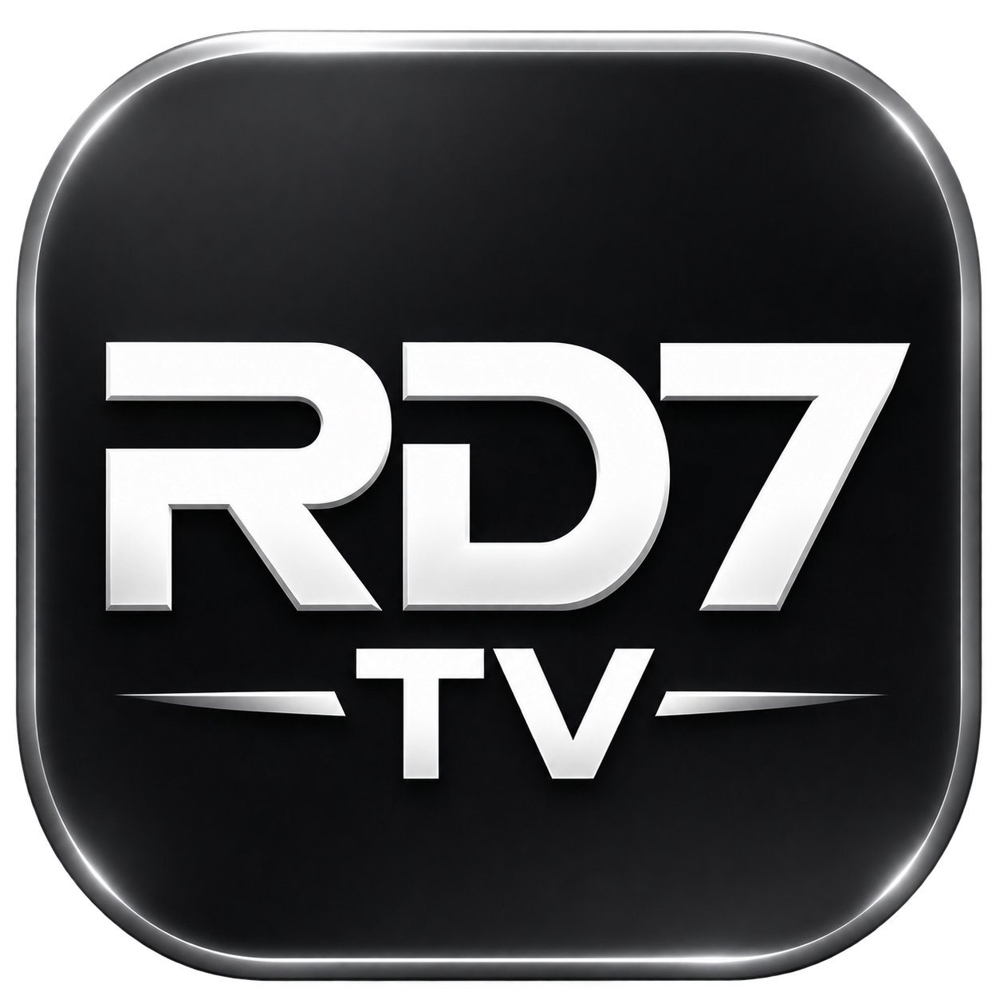
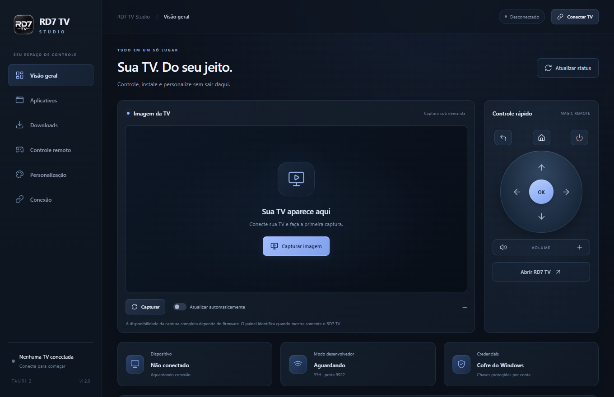
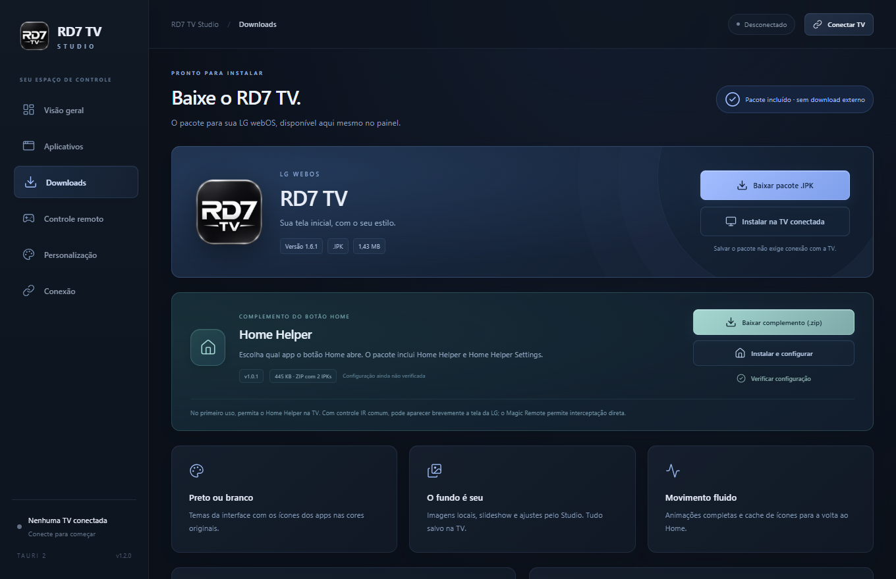
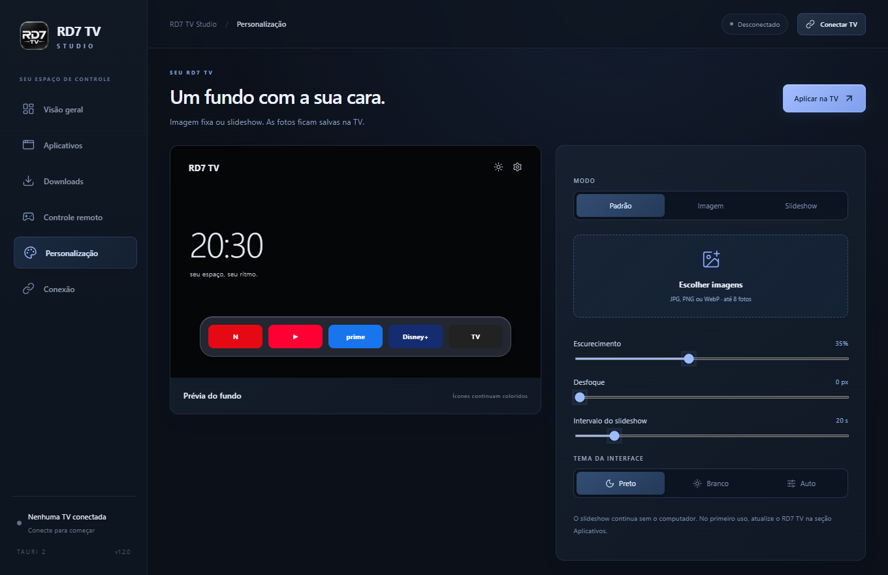

<p align="center"></p>
<h1 align="center">RD7 TV Studio</h1>
<p align="center">Sua LG webOS. Seu controle. Seu estilo.</p>
<p align="center">
  <a href="https://github.com/RD7Void/rd7-tv-studio/releases/latest"></a>
  <a href="LICENSE"></a>
  
</p>



Um painel desktop para conectar sua TV LG em Developer Mode, instalar apps, controlar a TV e personalizar a tela inicial **RD7 TV**. Construído com **Tauri v2 + Rust**, com interface animada e ícones locais.

## Downloads

| Pacote | Para que serve |
| --- | --- |
| [Instalador Windows .EXE — NSIS](https://github.com/RD7Void/rd7-tv-studio/releases/latest/download/RD7-TV-Studio-Setup.exe) | Instala o Studio na sua conta do Windows |
| [Executável portátil](https://github.com/RD7Void/rd7-tv-studio/releases/latest/download/RD7-TV-Studio.exe) | Abre o Studio sem instalação |
| [RD7 TV .IPK](https://github.com/RD7Void/rd7-tv-studio/releases/latest/download/RD7-TV.ipk) | Tela inicial para instalar na TV LG webOS |
| [Home Helper .ZIP](https://github.com/RD7Void/rd7-tv-studio/releases/latest/download/RD7-TV-Home-Helper_1.0.1.zip) | Dois apps para configurar o botão Home do controle |
| [SHA-256](https://github.com/RD7Void/rd7-tv-studio/releases/latest/download/SHA256SUMS.txt) | Verificação dos arquivos distribuídos |

**Windows 10/11 x64**, WebView2 e OpenSSH Client. A TV e o PC devem estar na mesma rede. O Windows pode exibir aviso para executáveis sem assinatura digital; esta distribuição não possui certificado de assinatura de código.

## Recursos

- **Conexões salvas:** perfis locais e chaves no Gerenciador de Credenciais do Windows.
- **Aplicativos:** lista, abertura e instalação de pacotes `.ipk` por SSH.
- **Controle remoto:** direcional, Home, voltar, volume, mudo, entradas e envio de texto.
- **Downloads integrados:** RD7 TV e Home Helper disponíveis mesmo sem conectar uma TV.
- **Personalização:** imagem fixa ou slideshow com até oito imagens, intervalo, desfoque e escurecimento.
- **RD7 TV:** temas claro e escuro, ícones dos apps em suas cores originais e animações.
- **Home Helper:** instalação e configuração do RD7 TV como destino do botão Home.

> **Prévia:** a captura completa depende das permissões do firmware. Na TV validada, a API foi bloqueada e o painel mostra capturas somente do RD7 TV. Espelhamento de vídeo da tela inteira ainda não está implementado.

<details>
<summary><b>Ver Downloads e Personalização</b></summary>




</details>

## Usar

1. Abra `RD7-TV-Studio.exe` ou instale pelo instalador.
2. Em **Conexão**, selecione a TV salva ou informe nome, IP e a passphrase do Developer Mode. No primeiro acesso, ative **Key Server** na TV.
3. Clique em **Conectar e salvar**. As chaves são guardadas no Gerenciador de Credenciais do Windows, por conta de usuário. A passphrase não é salva em texto.
4. Clique em **Parear controle** e permita o painel na TV. Esse pareamento é separado do SSH.
5. Em **Aplicativos**, instale pacotes `.ipk` ou atualize o RD7 TV com o pacote integrado.
   Em **Downloads**, use **Baixar pacote .IPK** para salvar o RD7 TV no computador, mesmo sem uma TV conectada, ou **Instalar na TV conectada** para instalar diretamente. O pacote está incluído no painel e não depende de um servidor externo.
   A mesma aba inclui **Home Helper**: baixe o ZIP com os dois IPKs necessários ou clique em **Instalar e configurar**. O painel seleciona RD7 TV como destino do botão Home e inicia o Helper. Permita a conexão na TV se aparecer a solicitação; depois, use **Verificar configuração**. Se o complemento já estiver instalado, o painel preserva a instalação e configura o destino.
6. Em **Personalização**, selecione imagem fixa ou slideshow, até oito imagens, e ajuste escurecimento, desfoque e intervalo. Clique em **Aplicar na TV**. O RD7 TV guarda as imagens e as configurações na própria TV; não precisa do PC ligado.

O botão Home do painel abre RD7 TV. As teclas direcionais, Enter e Esc funcionam na seção Controle remoto quando o foco não está em um campo de texto.

O Home Helper controla o botão Home do controle físico. No Magic Remote, ele permite a interceptação direta; em controles IR comuns pode haver um breve flash da tela da LG. Para restaurar o comportamento original, escolha LG Home no app Home Helper Settings. Não execute dois interceptadores de Home ao mesmo tempo.

## Imagem da TV

O painel primeiro tenta a captura completa disponibilizada pelo firmware da TV. Quando essa API é negada, usa o inspetor de Developer Mode para mostrar **apenas a interface do RD7 TV**, e identifica essa limitação na tela. Nesse modo, mantenha RD7 TV aberto. Não representa o vídeo de HDMI nem de outros apps. Conteúdo protegido também pode retornar uma captura preta pela API da TV.

A atualização automática é opcional e faz capturas a cada 2,2 segundos enquanto a seção Visão geral está visível. Não é transmissão de vídeo a 60 fps.

## Developer Mode

- TV e computador precisam estar na mesma rede.
- O OpenSSH Client do Windows é necessário (`ssh.exe` e `ssh-keygen.exe`).
- Após o primeiro acesso, o Key Server pode ser desligado. Developer Mode deve continuar ativo e sua sessão deve ser renovada na TV.
- A identidade SSH da TV é registrada no primeiro acesso. Uma alteração posterior é recusada pelo OpenSSH. Se a TV foi redefinida, confira a identidade antes de remover o arquivo `known_hosts` do painel.
- IPKs são enviados por SSH e só aparecem como instalados depois de a TV confirmar o estado final `installed`.
- O painel não usa a remoção de Developer Mode para apagar apps da loja.
- Os dados não secretos ficam em `%LOCALAPPDATA%\com.rd7.tvstudio`. Use **Esquecer TV** para remover a credencial salva.

## Compilar

Requisitos: Node.js LTS, Rust MSVC, Visual Studio C++ Build Tools, Windows SDK e WebView2.

```powershell
npm ci
npm run tauri -- build --bundles nsis
```

O projeto seleciona o toolchain MSVC pelo arquivo `rust-toolchain.toml`. Não altera o toolchain padrão de outros projetos.

Validação:

```powershell
npm run build
cargo test --release --manifest-path src-tauri/Cargo.toml --features tauri/custom-protocol
```

## Créditos

O RD7 TV é uma adaptação do projeto MIT [Free My TV](https://github.com/simbasjungles/free-my-tv), com integração ao Studio. O pacote integrado preserva o identificador `io.freemytv` para atualizar a instalação e manter o Home Helper. Licença e créditos estão em `THIRD-PARTY-NOTICES.md` e `LICENSE-FreeMyTV`.

O backend do Studio é Rust; não precisa de Python ou Node.js para funcionar depois de compilado. O frontend é distribuído dentro do executável Tauri.

O Tauri v2 integra o empacotador NSIS e obtém suas ferramentas durante a compilação. O instalador é gerado em `src-tauri/target/release/bundle/nsis/`; o executável fica em `src-tauri/target/release/`.

### Recompilar o app da TV

O código adaptado está em `rd7-tv-source/`. Com Python 3:

```powershell
python rd7-tv-source/build-rd7.py
npm run tauri -- build --bundles nsis
```

O script recompila o IPK e atualiza o recurso integrado do Studio. Nenhuma passphrase ou configuração de uma TV pessoal é necessária para compilar.

## Estrutura

```text
src/                    Interface do Studio
src-tauri/src/          Backend Rust: SSH, SSAP, perfis e personalização
src-tauri/resources/    IPKs e Home Helper integrados
rd7-tv-source/          Código da adaptação para LG webOS
docs/images/            Ícone e capturas sem dados de conexão
```

## Licença e contribuições

O código do Studio é distribuído sob [MIT](LICENSE). Componentes de terceiros mantêm suas próprias licenças e créditos em [THIRD-PARTY-NOTICES.md](THIRD-PARTY-NOTICES.md). Este é um projeto independente, sem afiliação com LG.

Relate problemas em [Issues](https://github.com/RD7Void/rd7-tv-studio/issues), incluindo modelo, versão do webOS e passos para reproduzir. Remova IPs pessoais, passphrases e chaves dos anexos.
